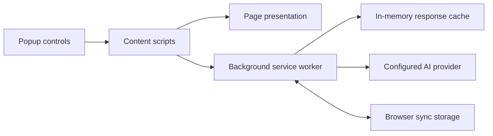

# ClarityAI
### A reading-assistant browser extension

ClarityAI adapts webpage presentation and offers AI-assisted text simplification and reading checklists. It is a prototype built with plain JavaScript, HTML, and CSS around a Manifest V3 extension.

## What is implemented

- **Focus mode:** identifies main content and hides common distractions.
- **Reading styles:** changes font, spacing, width, and background.
- **Simplification:** sends extracted text to a configured AI provider.
- **Reading checklist:** derives a checklist from page content.
- **Popup settings:** configures the provider, API key, model, and endpoint.
- **Response cache:** keeps recent AI responses in the background worker.

These are implementation features, not claims of measured accessibility or learning outcomes.

## Status and compatibility

This is a development prototype, not a verified browser-store release. Chrome/Edge and Firefox compatibility require separate testing. The original manifest used SVG icons, which Chrome does not support for manifest icons; the accompanying portfolio patch supplies PNG versions and updates the paths.

Browser-internal pages and some restricted pages cannot run content scripts. Page heuristics can hide useful elements or select the wrong content. Reload the page if restoring the original view does not restore interactive behavior.

## Try it locally

1. Clone this repository.
2. Open your Chromium browser's extensions page, enable Developer mode, and choose **Load unpacked**.
3. Select the repository root containing `manifest.json`.
4. Serve the included demo from the repository root:

   ```bash
   python -m http.server 8080
   ```

5. Open `http://localhost:8080/demo/demo-article.html`.
6. Open the extension popup and try Focus and reading-style modes.
7. For AI features, open the popup settings, enter your provider credentials, and save.

There is no package installation or build step. The extension does **not** read a `.env` file; configure it through the popup.

Provider defaults are defined in [lib/llm.js](lib/llm.js). Model availability, billing, endpoint compatibility, and browser request behavior depend on the provider and need live verification. Do not commit credentials.

## Privacy and permissions

- Focus and reading styles work without an AI call.
- AI features transmit extracted page text to the provider you configure. Avoid using them on sensitive pages.
- Settings, including the API key, currently use `chrome.storage.sync`. They can sync through your browser account; this is not a secure credential vault.
- The manifest grants access to all URLs. Narrower permissions and local-only credential storage are follow-up work.
- A custom endpoint receives the configured key and page text. Use only an endpoint you trust.

## Architecture



| Path | Responsibility |
| --- | --- |
| `manifest.json` | Permissions, popup, scripts, and background worker |
| `popup/` | Controls and settings |
| `content/modes/` | Page transformations |
| `content/utils/` | Content selection and checklist UI |
| `background/background.js` | Message routing, configuration, and caching |
| `lib/` | Provider clients, prompts, and storage |
| `demo/demo-article.html` | Repeatable local demo |

## Validation and current limits

The accompanying workflow checks JavaScript syntax, parses the manifest, and verifies declared assets. It does not test browser installation, AI calls, page layouts, or accessibility outcomes.

Before presenting: load the extension in the target browser; test all modes, reset, repeated toggles, provider errors, and navigation. The simplification cache uses only the first 200 text characters and can reuse an inappropriate response; improve the cache key before relying on it.

## Contributing and license

See [CONTRIBUTING.md](CONTRIBUTING.md). Some older contribution instructions may need aligning with this prototype's current setup. Licensed under the existing [MIT license](LICENSE).
